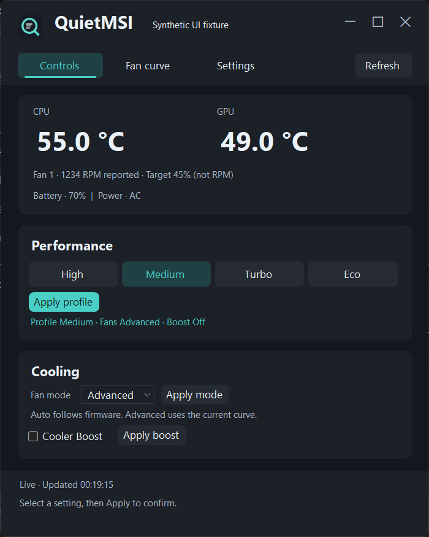

<div align="center">


# QuietMSI

**A small native Windows app for MSI laptop temperatures, performance and cooling.**

[](#experimental-status)
[](#requirements)
[](LICENSE)

[Download](https://github.com/boudywho/QuietMSI/releases) · [Report a bug](https://github.com/boudywho/QuietMSI/issues/new?template=bug_report.yml) · [Contribute](CONTRIBUTING.md)

</div>

## Experimental status

**This project is still very experimental.** Hardware support is narrow, and this is
not a general replacement for every MSI Center feature or every MSI laptop.
Use it only on supported hardware, monitor temperatures after changes, and report
problems with your model and firmware versions. Current downloads are experimental
prereleases. QuietMSI is an independent community project, not affiliated with MSI.

## What it does

QuietMSI puts the controls you use most into a compact native dashboard inspired
by G-Helper. It works independently of MSI Center using Windows WMI/ACPI and its
own firmware schema. No proprietary MSI DLLs are bundled, and it installs no
additional kernel driver or background service.

- Live CPU/GPU temperatures, reported fan RPM, battery level and power source.
- High, Medium, Turbo and Eco performance levels, with explicit Apply controls.
- Auto/Advanced fan modes and Cooler Boost.
- A bounded CPU fan-curve editor with session-original restoration.
- Borderless window, tray operation, and System/Light/Dark themes in Settings.
- Optional elevated startup with Windows, plus on-demand GitHub release checks.
- Self-contained **installer** and **portable** editions: no separate .NET runtime needed.



*Actual application UI with synthetic demonstration readings. Hardware values vary.*

## Download and install

Get both editions from [GitHub Releases](https://github.com/boudywho/QuietMSI/releases).
Each release includes SHA-256 checksums.

| Edition | Download | How to use it |
| --- | --- | --- |
| Installer | `QuietMSI-<version>-Setup-x64.exe` | Install into Program Files, with a Start menu shortcut and an optional desktop shortcut. Remove through Windows Installed apps. |
| Portable | `QuietMSI-<version>-Portable-win-x64.zip` | Extract into a stable folder and run `QuietMSI.exe`. No application installation or shortcuts. |

Both editions request administrator permission through normal Windows UAC.
First setup prepares QuietMSI-owned firmware support under
`%ProgramFiles%\QuietMSI\Support`. Portable describes application deployment;
protected hardware access still needs this shared machine registration.
Windows WMI/ACPI and your graphics driver must remain installed.
These builds are currently unsigned.

### Requirements

| Requirement | Current support |
| --- | --- |
| OS / architecture | Windows 10 1809 or newer, x64; local validation on Windows 11 |
| Laptop | **MSI GF63 Thin 11UCX** |
| EC firmware / WMI version | **16R6EMS1.106 / 2.8** |
| MSI Center | Not required; telemetry and control readback tested after its removal |
| .NET Desktop runtime | Included in both downloads |

Related models and different firmware are not automatically supported. Failed
identity checks, stale readings or conflicting state block hardware changes.
Cold-boot independence after MSI removal has not yet been verified in the recorded
local test. See [standalone verification](docs/standalone-verification.md).

## Using QuietMSI

1. Open **Controls** to view telemetry. Select a performance level, fan mode or
   boost setting, then press its **Apply** button. Draft selections alone do not write hardware.
2. Open **Fan curve** for the CPU curve. Changes can only increase cooling relative
   to the table captured for the current app session. Fixed temperature points and
   unknown firmware bytes are preserved.
3. Open **Settings** for appearance, startup and updates.

Close or minimize keeps the app in the tray. Use **tray → Exit** to stop it.
Starting a second copy reopens the running window. Hardware settings are never
changed automatically at startup, during polling, on resume, or on exit.

**Start with Windows** uses an elevated Task Scheduler logon task, so it appears
under **Task Scheduler Library → QuietMSI**, rather than Task Manager's Startup apps.
It starts in the tray about ten seconds after sign-in and stores no password.

### Updates

Choose **Settings → Check for updates** to query this repository's GitHub releases,
including experimental releases. **Open releases** opens the download page in your
browser. Checks are manual; QuietMSI does not silently download or execute updates.

For an installed copy, exit through the tray and run the newer installer. It reuses
the installation directory and uninstall entry, keeps appearance settings and startup
opt-in, and refuses to downgrade a newer installation. The same-version installer
can repair application files. An enabled startup task for the installing user also
moves to the installed executable when switching from portable.

For portable, exit and replace the extracted application with the newer package.
If the folder changes, enable startup again to update the path. Disable startup
before deleting a portable copy.

Preferences and logs live in `%LOCALAPPDATA%\QuietMSI`. Uninstall retains these and
the small shared firmware support registration so portable copies remain usable.
See [distribution details](docs/distribution.md).

## Limits to understand

- Only the listed model and firmware have a verified writable policy.
- Fan RPM is firmware-reported and has not been independently calibrated.
- Battery charge limits, MUX switching, GPU curves, overclocking and full MSI
  scenario automation are not implemented.
- Restore returns the exact CPU curve captured during this session; it is not a
  factory reset. Restore before exiting if you want that curve back. Exit sends no
  hardware command. Auto mode does not undo an edited curve automatically.
- Running another hardware-control utility can cause conflicts. Readback drift is
  reported rather than silently retried.

## Build and test

Install the [.NET 8 SDK](https://dotnet.microsoft.com/download/dotnet/8.0) and
[Inno Setup 6.6+](https://jrsoftware.org/isdl.php) on Windows, then run:

```powershell
.\build.ps1 -Dotnet dotnet -Iscc 'C:\Program Files (x86)\Inno Setup 6\ISCC.exe'
```

The build runs core, read-only hardware, UI, update-parser and 1,000-sample UI stress
checks, then produces both distributions and `SHA256SUMS.txt` under `artifacts`.
Normal tests do not modify firmware settings. The separate hardware write acceptance
modes require informed authorization; do not run those casually.

```powershell
dotnet run --project tests/QuietMSI.Tests -c Release
dotnet run --project tests/QuietMSI.HardwareTests -c Release
dotnet run --project tests/QuietMSI.UITests -c Release
dotnet run --project tests/QuietMSI.UpdateTests -c Release
```

The app uses C#/.NET 8, WinForms and System.Management. Source is organized into
`src/QuietMSI.Core` (policies and transactions), `src/QuietMSI` (Windows hardware/UI),
and `src/QuietMSI.Firmware` (owned schema resource). Release packaging lives in
`installer/QuietMSI.iss` and `build.ps1`.

## Contributing and support

Bug reports, reproducible test cases and UI improvements are welcome. Read
[CONTRIBUTING.md](CONTRIBUTING.md) before changing hardware support. Include your
model, EC firmware, app version, Windows version, steps to reproduce and expected
behavior. Screenshots help; redact personal information and inspect diagnostic logs
before sharing them.

[Security](SECURITY.md) · [Hardware protocol](docs/hardware-specs.md) ·
[Verification](docs/stability-verification.md) · [Third-party notices](THIRD-PARTY-NOTICES.md)

## License and credits

Original QuietMSI code is [MIT licensed](LICENSE). Microsoft .NET and dependencies
retain their own licenses; release packages include runtime notices. Proprietary MSI
binaries and decompiled source are not distributed. G-Helper inspired the compact
control layout; protocol references are attributed in the hardware documentation.
